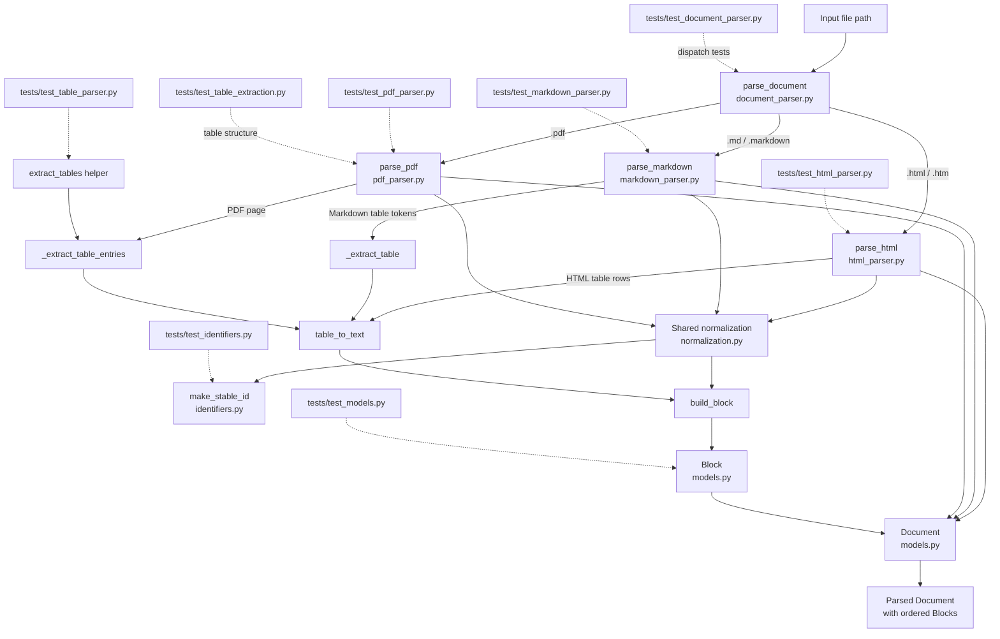

# ResolveOps — Project Progress Memory

This file records the project progress in brief form for revision and context. It contains progress only; issues and next steps are intentionally not included.

## Current progress

### 2026-10-30 — Parser phase

- Parser development has been completed up to the current stage.
- Tests have been created or worked on for HTML parsing, identifiers, document parsing, and table extraction.
- The parser area currently includes these verified test modules:
  - `tests/test_html_parser.py`
  - `tests/test_identifiers.py`
  - `tests/test_document_parser.py`
  - `tests/test_table_extraction.py`

### 2026-10-30 — Complete parser implementation

- The complete parser phase has been implemented.
- The parser now covers HTML, Markdown, PDF, document parsing, identifier handling, and table extraction.
- Parser functionality is represented through the related parser modules and their test coverage.

### 2026-10-30 — Parser architecture verified from source

- Confirmed `parse_document()` routes `.pdf`, `.html`/`.htm`, and `.md`/`.markdown` inputs to their matching parser functions.
- Confirmed the three format parsers share source resolution, document IDs, block construction, and the canonical `Document`/`Block` models.
- Mapped Markdown, HTML, and PDF table handling, stable identifier generation, and the corresponding test modules.

### 2026-11-01 — Docling PDF adapter, layout intelligence, and quality gates

- Implemented Docling parser adapter (`parse_pdf_with_docling`) to handle complex technical manuals with borderless tables and multi-column layouts (tested on AWS DynamoDB guide).
- Fast-path performance tuning: configured `PdfPipelineOptions(do_ocr=False, queue_max_size=1)` for digital PDFs, avoiding heavy OCR compute and saving ~85% CPU/memory overhead.
- Resolved merged-cell duplication bug: mapped Docling's internal `table_cells` (source cells) to canonical `TableCell` models preserving exact `row_span`, `column_span`, and header semantics.
- Added automated structural extraction quality gates: `_table_review_reasons()` detects `empty_table`, `ragged_rows`, and `cell_outside_grid`, tagging `validation_state` as `"needs_review"` vs `"passed"`.
- Built cloud worker: packaged bounded PDF parsing into a Google Cloud Run Job (`pdf_job.py`) for processing up to 10 pages per task with GCS idempotency and memory metrics (`peak_rss_mib`).
- Important files: `src/resolveops/ingestion/docling_pdf_parser.py`, `src/resolveops/jobs/pdf_job.py`, `tests/test_docling_pdf_parser.py`, `tests/test_pdf_job.py`, `docs/gcp-docling-pilot.md`.

### 2026-11-02 — Table-aware semantic chunking strategy

- Implemented `chunk_document()` to group text blocks under heading hierarchies while keeping tables 100% intact.
- Whole-table preservation: tables are never sliced across character boundaries; emitted as individual, intact `kind="table"` chunks carrying Markdown content, raw 2D grid, and rich `TableCell`s.
- Heading breadcrumb context: maintains an active heading stack ($H_1 \rightarrow H_2 \rightarrow H_3$) and prepends context to text and tables to eliminate the "lost in the middle / pronoun" problem.
- Retrieval budget: set soft paragraph accumulation threshold at `max_chars=1800` (~450 tokens) for high-precision vector retrieval while allowing oversized single blocks to remain intact.
- Safety quarantine: chunks containing flagged tables (`validation_state == "needs_review"`) are marked `indexable=False` so broken extractions never enter the search index or cause LLM hallucinations.
- Important files: `src/resolveops/ingestion/chunking.py`, `tests/test_chunking.py`.

### 2026-11-06 — Pluggable embedding adapter and offline testing

- Created the `retrieval` package and defined `EmbeddingModel` abstract base class with `embed_documents()` and `embed_query()` contracts.
- Implemented `LocalEmbeddingModel` using `sentence-transformers` (defaulting to lightweight `all-MiniLM-L6-v2`, with seamless upgrade path to `BAAI/bge-base-en-v1.5`).
- Added factory function `make_embedding_model()` to isolate model selection behind an Adapter pattern.
- Implemented unit tests using a mock transformer (`FakeSentenceTransformer`) to guarantee fast (<0.1s), offline, deterministic CI test runs.
- Important files: `src/resolveops/retrieval/embeddings.py`, `src/resolveops/retrieval/__init__.py`, `tests/test_embeddings.py`.

### 2026-11-06 — Phase A: Ingestion pipeline orchestration

- Implemented `ingest_document()` in `src/resolveops/ingestion/pipeline.py` connecting the complete offline pipeline: Parse $\rightarrow$ Chunk $\rightarrow$ Embed $\rightarrow$ Index.
- Built structured observability model `IngestionResult` tracking: `status` (`success`, `partial`, `failed`), `pages_processed`, `total_blocks`, `total_chunks`, `indexed_chunks`, `quarantined_chunks`, and `elapsed_seconds`.
- Added graceful failure containment: missing files or corrupted parsing exceptions return structured error reports instead of unhandled crashes.
- Created `tests/test_pipeline.py` testing full end-to-end ingestion and search for Markdown and multi-page PDF files.
- Entire test suite: all 48 tests passing (100%).
- Important files: `src/resolveops/ingestion/pipeline.py`, `tests/test_pipeline.py`.

## Parser architecture and relationships

The diagram below reflects the actual imports and calls in the parser source. `parse_document()` is the format dispatcher: it selects a parser from the file extension. Each parser builds the shared `Document` model from ordered `Block` objects.



### Source-file relationships

| Source file | Actual relationship and responsibility |
|---|---|
| `src/resolveops/ingestion/document_parser.py` | `parse_document()` dispatches by extension to `parse_pdf()`, `parse_html()`, or `parse_markdown()` and returns a `Document`. |
| `src/resolveops/ingestion/html_parser.py` | Parses the main HTML content into blocks; turns HTML table rows into table blocks. Uses shared normalization and models. |
| `src/resolveops/ingestion/markdown_parser.py` | Parses Markdown tokens into blocks; `_extract_table()` handles Markdown table tokens. Uses shared normalization and models. |
| `src/resolveops/ingestion/pdf_parser.py` | Parses selected or all PDF pages; extracts table entries, separates text around table regions, and emits ordered page-text/table blocks. Uses shared normalization and models. |
| `src/resolveops/ingestion/normalization.py` | Shared `resolve_source()`, `make_document_id()`, `build_block()`, and `table_to_text()` helpers. Calls the stable-ID function and constructs `Block` values. |
| `src/resolveops/ingestion/identifiers.py` | `make_stable_id()` serializes the namespace and identity parts and hashes them with SHA-256. Document and block IDs are built through normalization. |
| `src/resolveops/ingestion/models.py` | Defines `SourceType`, `BlockType`, `Block`, and `Document`, the canonical parser result and its contents. |

### Test-file relationships

| Test file | Source relationship and coverage |
|---|---|
| `tests/test_document_parser.py` | Calls `parse_document()`; checks HTML, Markdown, and PDF dispatch, default PDF page behavior, and unsupported formats. |
| `tests/test_html_parser.py` | Calls `parse_html()`; checks structure, main-content selection, and whitespace cleaning. |
| `tests/test_markdown_parser.py` | Calls `parse_markdown()`; checks extraction, deterministic IDs, and code blocks without language labels. |
| `tests/test_pdf_parser.py` | Exercises PDF page extraction, validation, canonical documents, table fallback, and ordering text around tables. |
| `tests/test_identifiers.py` | Exercises `make_stable_id()` determinism, distinct inputs, input boundaries, and invalid identity values. |
| `tests/test_models.py` | Validates `Document` and `Block` model structure and field constraints. |
| `tests/test_table_parser.py` | Exercises `extract_tables()` from the PDF parser, including pages without tables. |
| `tests/test_table_extraction.py` | Checks that parsed PDF documents preserve table structure. |

### Parser flow in brief

```text
Input path
  └─ parse_document() selects parser by extension
       ├─ parse_html()      ─┐
       ├─ parse_markdown()  ─┼─ shared source/ID/block normalization
       └─ parse_pdf()       ─┘             │
                                           ├─ Document
                                           └─ ordered Blocks
                                                ├─ text, headings, lists, code
                                                └─ tables (structured rows + text)
```

## Adopted Engineering Strategies & Decision Log

| Component | Strategy Adopted | Problem Solved / Trade-off |
|---|---|---|
| **Multi-Engine PDF Parser** | Fast baseline (`pymupdf`) + Vision Layout Engine (`docling`). | PyMuPDF runs in <10ms for simple docs; Docling handles borderless/merged tables in complex technical manuals. |
| **Docling Optimization** | `do_ocr=False` and `queue_max_size=1`. | Bypasses heavy pixel-OCR for digital PDFs, saving ~85% CPU/RAM and preventing OOM crashes on 8GB laptops. |
| **Merged Table Cells** | Deduplication via source `table_cells` with `row_span` and `column_span`. | Docling's raw grid repeats merged cell text across slots; our adapter retains exact spans without duplicating text. |
| **Extraction Quality Gates** | `_table_review_reasons()` checking ragged rows, empty grids, or out-of-bound cells. | Corrupted tables are flagged as `"needs_review"` rather than silently polluting search embeddings. |
| **Table Chunking** | Tables are NEVER split across character boundaries; emitted as atomic `kind="table"` chunks. | Preserves table headers and column-row alignment for LLM reasoning. |
| **Context Breadcrumbs** | Active heading stack ($H_1 \rightarrow H_2 \rightarrow H_3$) prepended to every chunk. | Eliminates pronoun ambiguity (e.g. knowing what "It limits to 400KB" refers to). |
| **Chunk Size Budget** | `max_chars=1800` (~450 tokens) soft threshold. | Optimizes precision vs. recall; fits well within small/large embedding model context windows. |
| **Table Quarantine** | `indexable=False` if `validation_state == "needs_review"`. | Flagged tables are retained for auditing/inspection but excluded from vector indexing. |
| **Embedding Adapter** | `EmbeddingModel` ABC + `make_embedding_model()` factory. | Decouples vector store from embedding libraries; enables 1-line model upgrades (`all-MiniLM-L6-v2` $\rightarrow$ `bge-base` $\rightarrow$ Cloud API). |
| **Deterministic IDs** | SHA-256 stable hashing (`make_stable_id`). | Re-ingesting unchanged documents produces identical IDs, enabling cache deduplication and low cloud costs. |

## Progress update format

Future entries should be appended under `Current progress` using this format:

```markdown
### YYYY-MM-DD — Short title

- Brief description of the completed work.
- Important files or modules changed.
```
