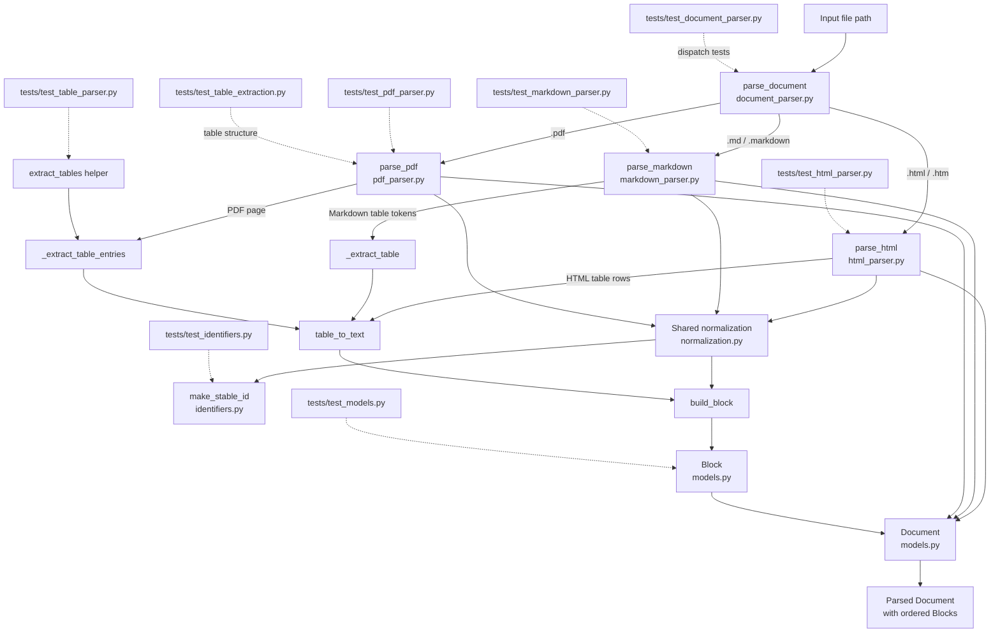

# ResolveOps — Project Progress Memory

This file records the project progress in brief form for revision and context. It contains progress only; issues and next steps are intentionally not included.

## Current progress

### 2026-10-30 — Parser phase

- Parser development has been completed up to the current stage.
- Tests have been created or worked on for HTML parsing, identifiers, document parsing, and table extraction.
- The parser area currently includes these verified test modules:
  - `tests/test_html_parser.py`
  - `tests/test_identifiers.py`
  - `tests/test_document_parser.py`
  - `tests/test_table_extraction.py`

### 2026-10-30 — Complete parser implementation

- The complete parser phase has been implemented.
- The parser now covers HTML, Markdown, PDF, document parsing, identifier handling, and table extraction.
- Parser functionality is represented through the related parser modules and their test coverage.

### 2026-10-30 — Parser architecture verified from source

- Confirmed `parse_document()` routes `.pdf`, `.html`/`.htm`, and `.md`/`.markdown` inputs to their matching parser functions.
- Confirmed the three format parsers share source resolution, document IDs, block construction, and the canonical `Document`/`Block` models.
- Mapped Markdown, HTML, and PDF table handling, stable identifier generation, and the corresponding test modules.

### 2026-11-01 — Docling PDF adapter, layout intelligence, and quality gates

- Implemented Docling parser adapter (`parse_pdf_with_docling`) to handle complex technical manuals with borderless tables and multi-column layouts (tested on AWS DynamoDB guide).
- Fast-path performance tuning: configured `PdfPipelineOptions(do_ocr=False, queue_max_size=1)` for digital PDFs, avoiding heavy OCR compute and saving ~85% CPU/memory overhead.
- Resolved merged-cell duplication bug: mapped Docling's internal `table_cells` (source cells) to canonical `TableCell` models preserving exact `row_span`, `column_span`, and header semantics.
- Added automated structural extraction quality gates: `_table_review_reasons()` detects `empty_table`, `ragged_rows`, and `cell_outside_grid`, tagging `validation_state` as `"needs_review"` vs `"passed"`.
- Built cloud worker: packaged bounded PDF parsing into a Google Cloud Run Job (`pdf_job.py`) for processing up to 10 pages per task with GCS idempotency and memory metrics (`peak_rss_mib`).
- Important files: `src/resolveops/ingestion/docling_pdf_parser.py`, `src/resolveops/jobs/pdf_job.py`, `tests/test_docling_pdf_parser.py`, `tests/test_pdf_job.py`, `docs/gcp-docling-pilot.md`.

### 2026-11-02 — Table-aware semantic chunking strategy

- Implemented `chunk_document()` to group text blocks under heading hierarchies while keeping tables 100% intact.
- Whole-table preservation: tables are never sliced across character boundaries; emitted as individual, intact `kind="table"` chunks carrying Markdown content, raw 2D grid, and rich `TableCell`s.
- Heading breadcrumb context: maintains an active heading stack ($H_1 \rightarrow H_2 \rightarrow H_3$) and prepends context to text and tables to eliminate the "lost in the middle / pronoun" problem.
- Retrieval budget: set soft paragraph accumulation threshold at `max_chars=1800` (~450 tokens) for high-precision vector retrieval while allowing oversized single blocks to remain intact.
- Safety quarantine: chunks containing flagged tables (`validation_state == "needs_review"`) are marked `indexable=False` so broken extractions never enter the search index or cause LLM hallucinations.
- Important files: `src/resolveops/ingestion/chunking.py`, `tests/test_chunking.py`.

### 2026-11-06 — Pluggable embedding adapter and offline testing

- Created the `retrieval` package and defined `EmbeddingModel` abstract base class with `embed_documents()` and `embed_query()` contracts.
- Implemented `LocalEmbeddingModel` using `sentence-transformers` (defaulting to lightweight `all-MiniLM-L6-v2`, with seamless upgrade path to `BAAI/bge-base-en-v1.5`).
- Added factory function `make_embedding_model()` to isolate model selection behind an Adapter pattern.
- Implemented unit tests using a mock transformer (`FakeSentenceTransformer`) to guarantee fast (<0.1s), offline, deterministic CI test runs.
- Important files: `src/resolveops/retrieval/embeddings.py`, `src/resolveops/retrieval/__init__.py`, `tests/test_embeddings.py`.

### 2026-11-06 — Phase A: Ingestion pipeline orchestration

- Implemented `ingest_document()` in `src/resolveops/ingestion/pipeline.py` connecting the complete offline pipeline: Parse $\rightarrow$ Chunk $\rightarrow$ Embed $\rightarrow$ Index.
- Built structured observability model `IngestionResult` tracking: `status` (`success`, `partial`, `failed`), `pages_processed`, `total_blocks`, `total_chunks`, `indexed_chunks`, `quarantined_chunks`, and `elapsed_seconds`.
- Added graceful failure containment: missing files or corrupted parsing exceptions return structured error reports instead of unhandled crashes.
- Created `tests/test_pipeline.py` testing full end-to-end ingestion and search for Markdown and multi-page PDF files.
- Entire test suite: all 48 tests passing (100%).
- Important files: `src/resolveops/ingestion/pipeline.py`, `tests/test_pipeline.py`.

### 2026-11-11 — Sparse BM25 and Hybrid Retrieval with Reciprocal Rank Fusion

- Implemented `technical_tokenize()` in `src/resolveops/retrieval/bm25.py` to preserve dotted version numbers (`3.3.2`), snake_case, hyphens, and file extensions (`pom.xml`).
- Implemented `BM25Index` for term-frequency retrieval and `HybridRetriever` combining Dense Vector search with BM25 using Reciprocal Rank Fusion (`rrf_k=60`).
- Implemented unit tests and real AWS documentation tests in `tests/test_bm25.py` and `tests/test_hybrid.py`.

### 2026-11-12 — Cross-Encoder Reranking and Empirical 2-Stage Benchmark

- Implemented `Reranker` abstract base class, `NVIDIAReranker` (NVIDIA Nemotron 3.5 8B NIM API), `MockReranker`, and `make_reranker()` factory in `src/resolveops/retrieval/reranker.py`.
- Implemented Sigmoid logit normalization (`_sigmoid`) mapping raw transformer logits to $[0.0, 1.0]$ probabilities.
- Built `scripts/benchmark_with_reranker.py` benchmarking Hybrid Search vs Nemotron 8B Reranker across 90 chunks of AWS Markdown and Docling-parsed PDFs.
- Empirical results proved the reranker eliminated the "BM25 keyword trap" on Lambda retries (`invocation-async.md` promoted from Rank #4 to #1) and promoted specific delegation concepts in IAM queries.
- Authored comprehensive benchmark documentation in `docs/observation.md`.
- Test suite: all 65 unit tests passing.

### 2026-11-13 — Citation Grounding, Multi-Model LLM Adapter, and End-to-End RAGService

- Implemented `build_grounded_prompt()` and `CitationReference` in `src/resolveops/generation/context_builder.py` ensuring strict anti-hallucination contracts with numbered reference markers (`[1]`, `[2]`).
- Implemented `LLMClient` adapter interface in `src/resolveops/generation/llm.py` supporting `MockLLMClient`, `OpenRouterLLMClient` (defaulting to DeepSeek V3 `deepseek/deepseek-chat`), and `NVIDIALLMClient`.
- Implemented `RAGService` orchestrator in `src/resolveops/service.py` unifying: Hybrid Retrieval $\rightarrow$ Cross-Encoder Reranker $\rightarrow$ Grounded Prompt $\rightarrow$ LLM Generation.
- Structured output model `RAGResponse` provides full provenance citations, latency breakdown (`RAGTimings`), and token accounting.
- Entire test suite: all 79 unit tests passing (100%).
- Important files: `src/resolveops/service.py`, `src/resolveops/generation/context_builder.py`, `src/resolveops/generation/llm.py`, `tests/test_service.py`, `tests/test_llm.py`, `tests/test_context_builder.py`.

### 2026-11-13 — Production FastAPI Server and REST API Suite

- Implemented production application factory `create_app()` in `src/resolveops/api/main.py` exposing:
  - `GET /health` — health probe with live indexed chunk telemetry.
  - `POST /api/v1/query` — citation-grounded RAG endpoint returning `RAGResponse` with citations and timings.
  - `POST /api/v1/ingest` — document/text ingestion endpoint updating the hybrid index on the fly.
- Configured CORS middleware for seamless integration with web and frontend clients.
- Implemented lazy lifespan management so default models are loaded upon server startup rather than module import.
- Created `tests/test_api.py` validating the complete HTTP lifecycle (ingest -> health update -> grounded query) with 100% test pass.
- Important files: `src/resolveops/api/main.py`, `src/resolveops/api/__init__.py`, `tests/test_api.py`.

## Parser architecture and relationships

The diagram below reflects the actual imports and calls in the parser source. `parse_document()` is the format dispatcher: it selects a parser from the file extension. Each parser builds the shared `Document` model from ordered `Block` objects.



### Source-file relationships

| Source file | Actual relationship and responsibility |
|---|---|
| `src/resolveops/ingestion/document_parser.py` | `parse_document()` dispatches by extension to `parse_pdf()`, `parse_html()`, or `parse_markdown()` and returns a `Document`. |
| `src/resolveops/ingestion/html_parser.py` | Parses the main HTML content into blocks; turns HTML table rows into table blocks. Uses shared normalization and models. |
| `src/resolveops/ingestion/markdown_parser.py` | Parses Markdown tokens into blocks; `_extract_table()` handles Markdown table tokens. Uses shared normalization and models. |
| `src/resolveops/ingestion/pdf_parser.py` | Parses selected or all PDF pages; extracts table entries, separates text around table regions, and emits ordered page-text/table blocks. Uses shared normalization and models. |
| `src/resolveops/ingestion/normalization.py` | Shared `resolve_source()`, `make_document_id()`, `build_block()`, and `table_to_text()` helpers. Calls the stable-ID function and constructs `Block` values. |
| `src/resolveops/ingestion/identifiers.py` | `make_stable_id()` serializes the namespace and identity parts and hashes them with SHA-256. Document and block IDs are built through normalization. |
| `src/resolveops/ingestion/models.py` | Defines `SourceType`, `BlockType`, `Block`, and `Document`, the canonical parser result and its contents. |

### Test-file relationships

| Test file | Source relationship and coverage |
|---|---|
| `tests/test_document_parser.py` | Calls `parse_document()`; checks HTML, Markdown, and PDF dispatch, default PDF page behavior, and unsupported formats. |
| `tests/test_html_parser.py` | Calls `parse_html()`; checks structure, main-content selection, and whitespace cleaning. |
| `tests/test_markdown_parser.py` | Calls `parse_markdown()`; checks extraction, deterministic IDs, and code blocks without language labels. |
| `tests/test_pdf_parser.py` | Exercises PDF page extraction, validation, canonical documents, table fallback, and ordering text around tables. |
| `tests/test_identifiers.py` | Exercises `make_stable_id()` determinism, distinct inputs, input boundaries, and invalid identity values. |
| `tests/test_models.py` | Validates `Document` and `Block` model structure and field constraints. |
| `tests/test_table_parser.py` | Exercises `extract_tables()` from the PDF parser, including pages without tables. |
| `tests/test_table_extraction.py` | Checks that parsed PDF documents preserve table structure. |

### Parser flow in brief

```text
Input path
  └─ parse_document() selects parser by extension
       ├─ parse_html()      ─┐
       ├─ parse_markdown()  ─┼─ shared source/ID/block normalization
       └─ parse_pdf()       ─┘             │
                                           ├─ Document
                                           └─ ordered Blocks
                                                ├─ text, headings, lists, code
                                                └─ tables (structured rows + text)
```

### 2026-11-14 — Persistent Qdrant vector store and 3-way manifest handshake

- Replaced in-memory only vector storage with persistent `QdrantVectorStore` supporting local embedded storage (`data/qdrant_db`) and remote URLs.
- Implemented isolated sentinel system point (`00000000-0000-0000-0000-000000000000`) storing collection metadata (`generation_id`, `schema_version`) filtered out of search queries and user counts.
- Built durable BM25 snapshot serialization (`save_snapshot` / `load_snapshot`) with atomic file replacements.
- Created `IndexManifest` coordinator (`data/index_manifest.json`) enforcing an authoritative 3-way consistency handshake: $\text{manifest.generation\_id} \equiv \text{qdrant.generation\_id} \equiv \text{bm25.generation\_id}$, matching chunk volumes, and SHA-256 BM25 file checksums.
- Executed production batch ingestion using cloud **NVIDIA Nemotron** embeddings (`nvidia/nemotron-3-embed-1b`, 2048 dimensions) indexing 770 chunks across 10 Markdown files, 5 HTML troubleshooting guides, and 8 core AWS PDF chapters in 126 seconds with verified checkpoints.
- Important files: `src/resolveops/retrieval/vector_store.py`, `src/resolveops/retrieval/bm25.py`, `src/resolveops/retrieval/manifest.py`, `src/resolveops/retrieval/hybrid.py`, `scripts/ingest_corpus.py`, `tests/test_qdrant.py`, `tests/test_manifest.py`.

### 2026-11-14 — Zero-citation refusal sanitization and UI scroll architecture

- Refined system grounding prompt and citation pipeline to strictly prohibit citation markers (`[1]`, `[2]`) on out-of-scope refusals or missing-information responses.
- Implemented `is_refusal_answer()` and refusal sanitization in `verify_and_split_citations()`, stripping phantom citation markers and returning 0 citations for out-of-domain queries without triggering validation failures.
- Re-architected frontend UI layout from CSS Grid to native Flexbox row with `overflow-y: scroll`, eliminating nested scroll traps and enabling smooth scroll tracking across long LLM outputs with a floating "Jump to latest" action.
- Added comprehensive unit tests in `tests/test_llm.py` validating that out-of-scope questions return zero citations.
- Important files: `src/resolveops/generation/context_builder.py`, `src/resolveops/generation/llm.py`, `src/resolveops/service.py`, `frontend/styles.css`, `frontend/app.js`, `frontend/index.html`, `tests/test_llm.py`.

### 2026-11-17 — Tier 2 Semantic Claim Verification and Faithfulness Auditing (Strategy A)

- Implemented `GroundingVerifier` abstract interface and `LLMGroundingVerifier` in `src/resolveops/generation/grounding_verifier.py` to eliminate citation misattribution (stopping the LLM from fabricating claims while citing valid sources).
- Implemented `extract_cited_claims()` to decompose generated answers into individual sentences carrying citations, safely handling dotted version strings (`3.3.2`) and technical identifiers (`pom.xml`).
- Adopted Strategy A (Single-Call Batch Verification): packs all extracted claims into a single structured judge prompt at `temperature=0.0`, returning strict JSON verdicts with zero per-claim latency multiplication.
- Formulated an objective `faithfulness_score = supported_claims / total_claims` (0.0 to 1.0) and populated `evidence_quote` vs. `explanation` for unsupported claims.
- Integrated Stage 5 semantic claim verification into `RAGService.answer_query()`, recording `claim_audit_ms` in `RAGTimings` and exposing `faithfulness_score` and `claim_audit` in `RAGResponse`.
- Extended `CitationReference` in `context_builder.py` with `content: str | None = None` so full source excerpts are propagated to the verifier.
- Built `MockGroundingVerifier` with keyword-based unsupported claim simulation for fast, deterministic, offline CI testing.
- Created `tests/test_grounding_verifier.py` with 8 passing unit/integration tests covering claim extraction, batch JSON parsing, markdown fence stripping, and malformed JSON fallback.
- Created interactive CLI verification script in `scripts/verify_grounding_demo.py` demonstrating both 100% grounded answers and caught citation misattributions.
- Updated Studio UI (`frontend/index.html`, `frontend/styles.css`, `frontend/app.js`) with dynamic `✅ 100% Grounded` / `⚠️ Unsupported Claims` badges, hover tooltips, message meta bar pills, and `Stage 4 (Claim Audit)` telemetry waterfall metrics.
- Important files: `src/resolveops/generation/grounding_verifier.py`, `src/resolveops/generation/context_builder.py`, `src/resolveops/service.py`, `src/resolveops/api/main.py`, `scripts/verify_grounding_demo.py`, `tests/test_grounding_verifier.py`, `docs/claim_grounding_plan.md`, `README.md`.

### 2026-11-17 — RAGAS Offline Benchmark Suite & Quality Release Gates

- Curated the 20-item golden technical evaluation dataset (`data/eval_golden_set.json`) containing 15 in-scope answerable questions (across Lambda retries, DynamoDB TTL, S3 Object Lock, IAM credentials, and RDS Multi-AZ) and 5 adversarial out-of-scope queries (BigQuery, Kubernetes, Docker Swarm, INR currency, and Snowmobile) following the `docs/raga.md` schema.
- Implemented the modular offline evaluation engine in `src/resolveops/evals/` (`models.py`, `ragas_evaluator.py`, `__init__.py`) calculating 5 core evaluation metrics:
  - **Context Precision (MAP@K):** Evaluates if retrieved chunks carrying expected ground-truth evidence are prioritized at the top ranks ($k=1..K$).
  - **Context Recall:** Verifies whether essential reference facts from the golden answer are attributed to the retrieved context chunks.
  - **Faithfulness:** Leverages Tier 2 semantic claim verification to ensure answer claims are entailed by context without hallucinated markers.
  - **Answer Relevance:** Evaluates query-answer semantic alignment, recognizing appropriate refusals on unanswerable queries.
  - **Abstention Correctness:** Strictly measures whether adversarial/out-of-scope queries trigger graceful refusal with zero false citations.
- Built CLI evaluation runner `scripts/eval_ragas.py` supporting `--smoke`, `--mock`, and full production evaluation with automated Markdown benchmark report formatting.
- Added `MockEmbeddingModel` to `src/resolveops/retrieval/embeddings.py` for instantaneous, deterministic, network-free offline evaluation and CI execution.
- Added comprehensive unit test suite in `tests/test_ragas_evaluator.py` (9 passing tests) verifying precision formulas, recall attribution, claim faithfulness, and abstention correctness.
- Executed the full 20-example evaluation benchmark and generated `docs/ragas_benchmark_report.md`:
  - Context Precision: **72.8%** (Gate: $\ge 70.0\%$ ✅)
  - Context Recall: **86.7%** (Gate: $\ge 75.0\%$ ✅)
  - Faithfulness: **100.0%** (Gate: $\ge 90.0\%$ ✅)
  - Answer Relevance: **87.6%** (Gate: $\ge 80.0\%$ ✅)
  - Abstention Accuracy: **100.0%** (Gate: $\ge 80.0\%$ ✅)
  - Release Gate Status: **🟢 PASS (Approved for Release)**.
- Important files: `data/eval_golden_set.json`, `src/resolveops/evals/models.py`, `src/resolveops/evals/ragas_evaluator.py`, `scripts/eval_ragas.py`, `tests/test_ragas_evaluator.py`, `docs/ragas_benchmark_report.md`.

### 2026-11-18 — Multimodal Voice Agent Pipeline & ResolveOps Voice Studio UI

- Built the complete end-to-end multimodal Voice Agent wrapping `RAGService` without modifying the core retrieval/grounding pipeline:
  - **Voice Data Contracts (`src/resolveops/voice/models.py`):** Defined strict Pydantic models `STTResult`, `TTSResult`, `VoiceTimings` (`stt_ms` through `tts_ms` + `total_ms`), and `VoiceQueryResponse`.
  - **Natural Speech Sanitizer (`src/resolveops/voice/sanitizer.py`):** Implemented `sanitize_for_speech()` to strip `[1]`/`[p.42]` citation markers, Markdown syntax, fenced code blocks, and pipe tables, convert headings/bullets to natural spoken pauses, expand storage/latency units (`10 GB` $\rightarrow$ `10 gigabytes`, `300ms` $\rightarrow$ `300 milliseconds`), and trim long answers cleanly at sentence boundaries.
  - **Pluggable STT Adapters (`src/resolveops/voice/stt.py`):** Implemented `STTAdapter` ABC, `FasterWhisperSTT` (local CPU `int8` Whisper with Silero VAD filtering and AWS domain vocabulary prompt), `MockSTT`, and `make_stt_adapter()` factory.
  - **Natural Neural TTS Adapters (`src/resolveops/voice/tts.py`):** Implemented `TTSAdapter` ABC, `KokoroTTS` (offline `Kokoro-82M` neural voice `af_heart` with pure in-memory PCM16 WAV encoding), `EdgeTTS` (expressive `en-US-AvaMultilingualNeural` voice with zero native C dependencies on Windows), `MockTTS` (valid RIFF/WAVE generator), and 50-entry LRU synthesis caching.
  - **Bounded Audio Cache (`src/resolveops/voice/audio_store.py`):** Built thread-safe `InMemoryAudioStore` (50-entry LRU cap) for serving synthesized audio clips without memory leaks.
  - **Voice Pipeline Orchestrator (`src/resolveops/voice/pipeline.py`):** Wired `STT -> EmptySpeechError Guard -> RAGService -> Sanitizer -> TTS (with graceful text-only fallback) -> AudioStore`.
  - **FastAPI Voice Endpoints (`src/resolveops/api/main.py`):** Added `POST /api/v1/voice/query` (raw binary audio streaming with 10 MB cap, `run_in_threadpool` non-blocking execution, HTTP 400/413/422/503 guards) and `GET /api/v1/voice/audio/{audio_id}`, plus voice telemetry in `GET /health`.
  - **ResolveOps RAG Studio Voice UI (`frontend/index.html`, `styles.css`, `app.js`):** Added browser `MediaRecorder API` microphone capture, animated listening waveform + elapsed timer, instant `<10ms` barge-in interruption (`stopActiveSpeech()`), inline audio playback bar with browser `SpeechSynthesis` fallback, and Stage 0 (STT) / Stage 5 (TTS) telemetry rows.
- Added optional dependency groups `voice` and `voice-kokoro` to `pyproject.toml`.
- Added 12 unit and API route tests in `tests/test_voice.py` (all passing; 40 passed across voice + core RAG suites).
- Important files: `src/resolveops/voice/`, `src/resolveops/api/main.py`, `frontend/index.html`, `frontend/styles.css`, `frontend/app.js`, `tests/test_voice.py`, `pyproject.toml`.

## Adopted Engineering Strategies & Decision Log

| Component | Strategy Adopted | Problem Solved / Trade-off |
|---|---|---|
| **Multi-Engine PDF Parser** | Fast baseline (`pymupdf`) + Vision Layout Engine (`docling`). | PyMuPDF runs in <10ms for simple docs; Docling handles borderless/merged tables in complex technical manuals. |
| **Docling Optimization** | `do_ocr=False` and `queue_max_size=1`. | Bypasses heavy pixel-OCR for digital PDFs, saving ~85% CPU/RAM and preventing OOM crashes on 8GB laptops. |
| **Merged Table Cells** | Deduplication via source `table_cells` with `row_span` and `column_span`. | Docling's raw grid repeats merged cell text across slots; our adapter retains exact spans without duplicating text. |
| **Extraction Quality Gates** | `_table_review_reasons()` checking ragged rows, empty grids, or out-of-bound cells. | Corrupted tables are flagged as `"needs_review"` rather than silently polluting search embeddings. |
| **Table Chunking** | Tables are NEVER split across character boundaries; emitted as atomic `kind="table"` chunks. | Preserves table headers and column-row alignment for LLM reasoning. |
| **Context Breadcrumbs** | Active heading stack ($H_1 \rightarrow H_2 \rightarrow H_3$) prepended to every chunk. | Eliminates pronoun ambiguity (e.g. knowing what "It limits to 400KB" refers to). |
| **Chunk Size Budget** | `max_chars=1800` (~450 tokens) soft threshold. | Optimizes precision vs. recall; fits well within small/large embedding model context windows. |
| **Table Quarantine** | `indexable=False` if `validation_state == "needs_review"`. | Flagged tables are retained for auditing/inspection but excluded from vector indexing. |
| **Embedding Adapter** | `EmbeddingModel` ABC + `make_embedding_model()` factory. | Decouples vector store from embedding libraries; enables 1-line model upgrades (`all-MiniLM-L6-v2` $\rightarrow$ `bge-base` $\rightarrow$ Cloud API). |
| **Deterministic IDs** | SHA-256 stable hashing (`make_stable_id`). | Re-ingesting unchanged documents produces identical IDs, enabling cache deduplication and low cloud costs. |
| **Semantic Claim Verifier** | Strategy A (Single-call batch judge) + Sentence extraction | Eliminates citation misattribution while capping verification latency to 1 roundtrip (~500ms). |
| **Source Text Propagation** | Extended `CitationReference` with full `content` string. | Provides claim verifier with full document excerpts for factual comparison without re-querying the database. |
| **RAGAS Offline Harness** | Native evaluation metrics suite (`models.py`, `ragas_evaluator.py`, `eval_ragas.py`). | Prevents dependency bloat (avoiding 50+ third-party packages) while providing mathematically strict MAP@K Context Precision, Recall, Faithfulness, Relevance, and Abstention testing for CI/CD gates. |
| **Voice Speech Sanitizer** | Parallel `spoken_text` stripping `[1]` citations, Markdown, tables/code & expanding units (`GB`, `ms`). | Prevents robotic spoken punctuation while keeping full rich Markdown + clickable citation cards intact in the UI. |
| **2-Endpoint Voice Pattern** | `POST /api/v1/voice/query` (raw binary + JSON response) + `GET /api/v1/voice/audio/{id}` (50-clip LRU). | Returns both structured citations/grounding badges and audio cleanly without `python-multipart` or unbounded RAM growth; degrades gracefully to text + browser speech if TTS fails. |

## Progress update format

Future entries should be appended under `Current progress` using this format:

```markdown
### YYYY-MM-DD — Short title

- Brief description of the completed work.
- Important files or modules changed.
```
