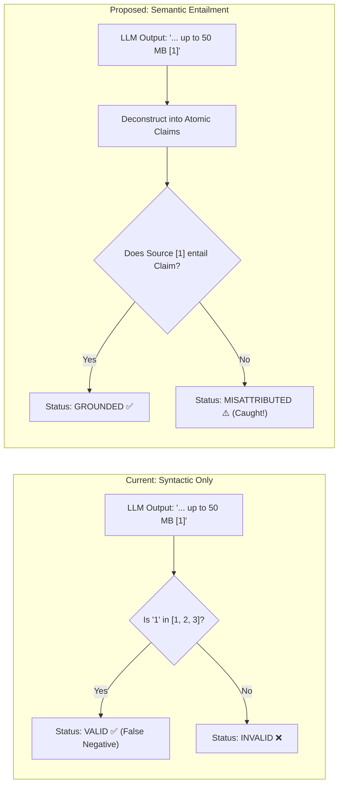
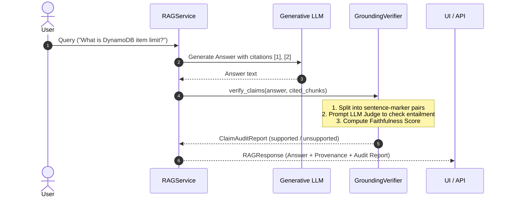

# 📐 Architecture Plan: Claim-Level Grounding & Citation Verification

> **Objective:** Upgrade ResolveOps from pure syntactic citation marker auditing to semantic claim-level entailment verification, eliminating citation misattribution and establishing quantitative faithfulness benchmarks.

---

## 1. Problem Statement: The Grounding Gap

Currently, `verify_and_split_citations()` performs a **Tier 1 Syntactic Audit**:
- It verifies that citation index `[i]` exists in the prompt candidate registry.
- It catches out-of-bounds references (e.g., `[7]` when only 3 sources were given).

### The Vulnerability: Citation Misattribution
If the LLM makes an ungrounded or exaggerated statement and appends a valid citation tag:
```text
Claim:  "Amazon DynamoDB allows item sizes up to 50 MB [1]."
Source: [1] Programming.Errors.md (only discusses HTTP 400 collection limits)
```
The regex auditor sees `[1]`, checks that `1 in cit_map`, and marks the answer **`VALID`** with `hallucinated_markers: []`. The system is blind to the fact that Source `[1]` does not support the claim.



---

## 2. Phased Roadmap

| Phase | Approach | Mechanism | Latency Impact | API Cost | Status |
| :--- | :--- | :--- | :--- | :--- | :--- |
| **Phase 1 (Production)** | **Tier 1 + Strategy A Batch Audit** | Regex Marker Check + Batch LLM Claim Verifier | $+500\text{--}900\,\text{ms}$ | 1 small LLM verification call | **✅ Completed** |
| **Phase 2 (Evaluation)** | **RAGAS Benchmark** | Quantitative Faithfulness & Citation Recall evaluation | Offline / CI | Batch LLM evaluation | ⏳ Next |
| **Phase 3 (Scaling)** | **Dedicated NLI Model** | Local Cross-Encoder / DeBERTa-v3-MNLI inference | $+30\text{--}60\,\text{ms}$ | **$0.00 (Zero API cost)** | ⏳ Future |

---

## 3. Phase 1 (Now): Technical Design

### A. Core Workflow Sequence



### B. Module Specifications

#### 1. Claim Decomposer & Model Contract
Create `src/resolveops/generation/grounding_verifier.py`:

```python
class ClaimStatus(str, Enum):
    SUPPORTED = "supported"          # Source explicitly entails claim
    UNSUPPORTED = "unsupported"      # Source does not mention or contradict claim
    PARTIAL = "partial"              # Source partially supports, minor extrapolation

class ClaimVerification(BaseModel):
    sentence: str                    # The specific claim sentence
    cited_marker: int                # [1], [2], etc.
    source_filename: str            # e.g. "Programming.Errors.md"
    status: ClaimStatus              # supported / unsupported
    evidence_quote: str | None       # Exact snippet from source supporting it
    explanation: str                 # Brief rationale if unsupported

class GroundingAuditReport(BaseModel):
    total_claims: int
    supported_claims: int
    unsupported_claims: int
    faithfulness_score: float        # supported_claims / total_claims (0.0 to 1.0)
    claims: list[ClaimVerification]
    unsupported_details: list[ClaimVerification]
```

#### 2. Verification Prompt (LLM-as-a-Judge)
A structured, low-temperature prompt executed against DeepSeek-V3 or lightweight model:

```text
You are an expert RAG Fact-Checking and Entailment Auditor.
Analyze each sentence in the answer that references a citation marker [i].
Compare the sentence strictly against the corresponding source excerpt [i].

For each claim, decide:
- "supported": The cited excerpt directly confirms the statement.
- "unsupported": The cited excerpt does not contain this information or contradicts it.

Output strict JSON list:
[
  {
    "sentence": "...",
    "marker": 1,
    "status": "supported" | "unsupported",
    "evidence_quote": "exact quote from source" (or null if unsupported),
    "explanation": "concise reason"
  }
]
```

#### 3. Configuration & Graceful Degradation
- Controlled via environment variable: `RESOLVEOPS_ENABLE_CLAIM_AUDIT=true` (defaults to `true`).
- If claim verification times out or fails, the core answer is preserved; the system logs a warning and marks `audit_status="skipped"` rather than failing the user query.

#### 4. UI Representation
- If `faithfulness_score == 1.0`: Displays green badge `100% Grounded`.
- If `unsupported_claims > 0`: Displays amber pill in the metadata bar:
  `⚠️ 1 Unsupported Claim` with tooltip highlighting the exact sentence and reason.

---

## 4. Phase 2: RAGAS Quantitative Evaluation Plan

Once Phase 1 is in place, create an offline benchmark suite (`scripts/eval_faithfulness.py`):

1. **Test Dataset (Golden Benchmark)**:
   - 20 curated technical queries across AWS Lambda, S3, IAM, and DynamoDB.
   - Includes 5 tricky edge cases (e.g. out-of-scope queries like "who is rajan", subtle boundary limits like 400KB vs 10MB).
2. **Evaluation Metrics via RAGAS**:
   - **Faithfulness**: Ratio of claims that can be inferred from the context.
   - **Answer Relevance**: Semantic similarity between query and generated response.
   - **Citation Recall**: Did the model cite all relevant retrieved chunks?
   - **Citation Precision**: Were all cited chunks actually necessary?

---

## 5. Phase 3: Migration to Dedicated Local NLI Model

### Why Migrate Later?
- **Cost**: Calling an LLM judge on every query doubles generative API token costs.
- **Latency**: An LLM call adds 600–1200ms. A local ONNX-quantized NLI model (`cross-encoder/nli-deberta-v3-small` or `bge-reranker-large`) runs locally on CPU/GPU in **20–40ms**.

### Architecture Evolution:
- Replace `LLMGroundingVerifier` with `NLIGroundingVerifier` adhering to the identical `GroundingVerifier` interface.
- Zero breaking changes to `RAGService`, `RAGResponse`, or the Web UI.

---

## 6. Implementation Status & Artifacts (Phase 1 Completed)

The Phase 1 Tier 2 Semantic Claim Verification engine is fully implemented and tested across the codebase:

1. **`src/resolveops/generation/grounding_verifier.py` (Core Engine)**:
   - `ClaimStatus`: Standardized enum (`supported`, `unsupported`, `partial`, `unverified`).
   - `ClaimVerification`: Per-claim record holding sentence, cited marker, source document, evidence quote, and rationale.
   - `GroundingAuditReport`: Aggregated report tracking `faithfulness_score` (0.0 to 1.0), claim counts, and latency.
   - `extract_cited_claims`: Decomposes generated answers into sentences with citations while safely preserving technical identifiers and dotted versions (`pom.xml`, `v3.3.2`).
   - `LLMGroundingVerifier`: Strategy A single-call batch prompt with markdown fence stripping and resilient JSON parsing.
   - `MockGroundingVerifier`: Offline deterministic verifier with keyword-based unsupported claim simulation for CI/CD.

2. **`src/resolveops/generation/context_builder.py` (Source Text Propagation)**:
   - Extended `CitationReference` with `content: str | None = None` populated during prompt assembly, giving the verifier access to complete source excerpts for factual comparison.

3. **`src/resolveops/service.py` (Pipeline Stage 5 Integration)**:
   - Added `claim_audit_ms` to `RAGTimings`.
   - Added `faithfulness_score` and `claim_audit` to `RAGResponse`.
   - Wired Stage 5 execution into `RAGService.answer_query()`, with automatic failure isolation (audit failure never crashes user queries).

4. **`src/resolveops/api/main.py` (Configurable Production Wiring)**:
   - Automatically initializes and injects `GroundingVerifier` based on `RESOLVEOPS_ENABLE_CLAIM_AUDIT` (default: `true`).

5. **`tests/test_grounding_verifier.py` (Comprehensive Test Suite)**:
   - 8 unit and integration tests passing:
     - Sentence claim extraction with multiple citations and punctuation.
     - 100% supported vs. misattribution detection with faithfulness scoring.
     - Strategy A batch JSON output parsing and markdown ````json ```` stripping.
     - Graceful degradation on malformed judge output or network exceptions.
     - End-to-end `RAGService` orchestrator execution.

6. **Interactive Verification & UI Artifacts**:
   - `scripts/verify_grounding_demo.py`: Ready-to-run CLI demonstration testing both a 100% grounded answer and a caught misattribution.
   - `frontend/index.html` & `app.js`: Live `✅ 100% Grounded` / `⚠️ Unsupported Claims` audit badges, hover explanations, message meta bar pills, and `Stage 4 (Claim Audit)` latency profile telemetry.

