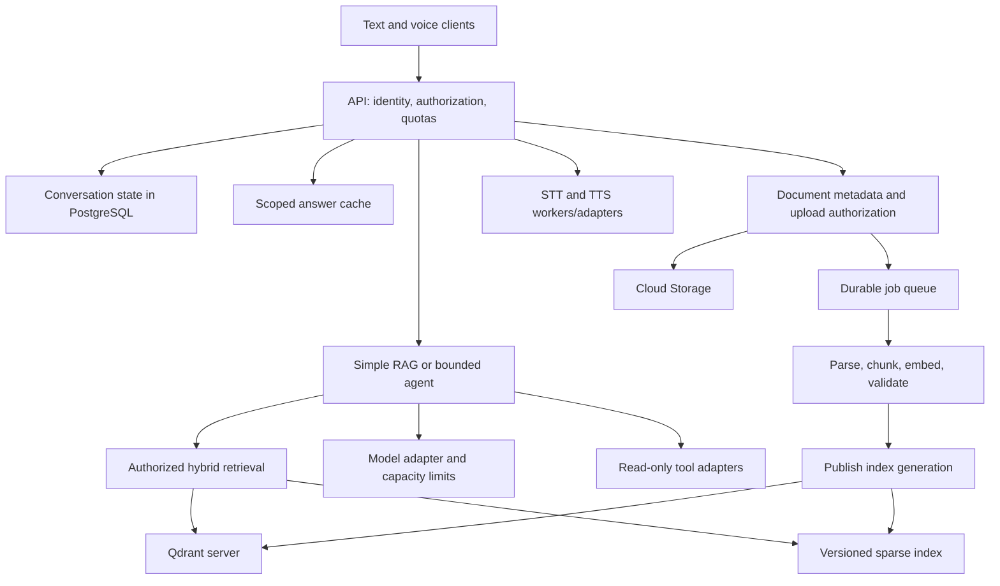

# ResolveOps: Production, Agentic RAG, Voice, and Scale Roadmap

Status: proposed implementation plan; no throughput or production-readiness claim is established by this document.

Planning horizon: 12 weeks for the core project, followed by optional scale experiments.

Budget: INR 30,000 in GCP credits over three months. Confirm credit expiry and service eligibility before provisioning.

## 1. Outcome and scope

Build an operations assistant that answers technical questions with evidence, remembers a conversation, investigates incidents through authorized tools, and supports spoken interaction.

Example: "Why are payments failing after the last deployment?" The assistant retrieves relevant runbooks, checks scoped logs and deployment metadata, distinguishes evidence from hypotheses, and suggests a next step. Initially, all operational tools are read-only.

The engineering outcomes are:

- A small deployed pilot with authentication, tenant isolation, durable state, monitoring, and demonstrated recovery.
- Measured retrieval and answer quality, including citation support and appropriate abstention.
- Bounded agent execution and interruptible conversational voice.
- Reproducible load tests that expose and explain bottlenecks.
- A 10,000 requests/second benchmark target for a precisely defined lightweight or cached workload; 100,000 RPS is a later stretch experiment.
- A final architecture and capacity exercise for 1,000,000 RPS, with clear conditions for testing it in the future.

The throughput targets are experiments, not promises that this budget can validate them. Complete the production and AI quality milestones even if a scale experiment stops below its target.

This document consolidates the forward implementation sequence. [plan.md](../plan.md) remains historical context; [voice-agent-plan.md](voice-agent-plan.md) contains candidate voice components; [claim_grounding_plan.md](claim_grounding_plan.md) contains grounding design ideas. Their latency, quality, and "zero-cost" statements must be validated: local inference still consumes compute, and citation checking cannot guarantee elimination of hallucinations.

## 2. Starting point in this repository

This is a targeted source inspection, not a fresh complete audit or test run.

| Existing area | Reuse | Work still needed for this roadmap |
| --- | --- | --- |
| `src/resolveops/ingestion/` | Parsers, normalization, stable identifiers, table-aware chunks, pipeline | Durable job lifecycle, tenant ownership, resumability, version publication |
| `src/resolveops/retrieval/vector_store.py` | In-memory and Qdrant implementations | Shared server deployment, authorized filtering, index lifecycle under multiple processes |
| `src/resolveops/retrieval/bm25.py` and `manifest.py` | Sparse index persistence and consistency checks | Replica freshness, shared generation publication, recovery across stores |
| `src/resolveops/retrieval/hybrid.py` | Dense/sparse fusion and mutation coordination | Current process-local `RLock` is not distributed coordination; benchmark read contention and redesign publication before scaling |
| `src/resolveops/service.py` | Retrieval, reranking, generation, citations, stage timings | Conversation state, streaming, cancellation, bounded agent orchestration |
| `src/resolveops/api/main.py` | Query/ingestion routes, ingestion key and request bounds | User identity, authorization on all data paths, quotas, durable state, readiness |
| `scripts/ingest_corpus.py` and `src/resolveops/jobs/pdf_job.py` | Corpus indexing and cloud worker foundation | General job queue, idempotent retries, progress records and failed-job recovery |

An ingestion API key is not a user/tenant authorization system. A persistent index is not a distributed transaction. Existing citation marker checks establish valid references, not semantic support for every claim.

Preserve whole tables and heading context. Keep the current chunking strategy as the baseline; evaluate overlap or parent/neighbor retrieval against actual boundary failures before changing it.

## 3. Workload definitions and success measures

Every benchmark must identify its workload. Do not combine these results into one unspecified RPS number.

| ID | Workload | What a successful completion means | Initial experiment |
| --- | --- | --- | --- |
| W0 | Protocol/health response | Valid fixed response; no retrieval or model work | Establish transport ceiling only |
| W1 | Authorized exact-cache answer | Identity and permissions checked; correctly scoped answer and citations returned | 100 -> 1k -> 10k RPS; 100k stretch |
| W2 | Retrieval only | Real embedding path declared, authorized dense/sparse search and optional rerank completed | Baseline, then increase until measured saturation |
| W3 | Full RAG | Real retrieval and model generation complete with valid response | 1 -> 5 -> 10 RPS; attempt 10-50 only within provider and budget limits |
| W4 | Agent investigation | Real tool/model steps finish or produce an explicit bounded failure | Measure tasks/second, steps/task and cost/task |
| W5 | Voice conversation | Audio input, reasoning, output and interruption work | 1 -> 5 -> 10 concurrent sessions initially |
| W6 | Mock-model application flow | Declared simulated model latency/output plus the stated real components | Isolate backend limits without paying for mass inference |

Voice sessions are not HTTP requests, and audio frames are not completed conversations. A queued `202` is accepted work, not a completed answer. Record these separately. W0 or W6 results cannot substantiate W3 capacity.

Provisional objectives, to confirm after baseline measurement:

- W1: p95 below 200 ms and p99 below 500 ms from the declared load-generator location, with fewer than 1% unexpected failures.
- W3: initially target p95 time to first token below 3 seconds and complete answer below 10 seconds for a fixed model, prompt budget and output limit. Report actual values even when the objective is missed.
- W5: initially target p95 end-of-user-speech to first answer audio below 3 seconds and interruption-to-playback-stop below 300 ms on the stated device/network.
- Quality: establish a reviewed baseline, then gate releases against regression. Do not choose an arbitrary faithfulness percentage before defining labels and evaluator agreement.
- Isolation: no cross-tenant disclosure in the authorization test matrix. Any observed leak blocks release.
- Pilot operations: work toward a 99.5% monthly successful-request availability objective within the published service envelope. A short load test cannot establish monthly availability.

Track offered, admitted, rejected, successful and completed traffic separately. Treat rejections as unmet offered demand when reporting capacity; do not increase the claimed RPS by returning errors quickly.

## 4. Architecture to build first

Start with a modular Python application, separate ingestion workers, and replaceable adapters. Extract additional services only when resource isolation or measured bottlenecks justify it.

Deployment progression:

1. Local containers for development: application, PostgreSQL, Qdrant, and Redis when its milestone starts.
2. Small GCP pilot: Cloud Run for API/jobs, Cloud Storage for documents, and one queue mechanism. Prefer Cloud Tasks for explicit bounded task dispatch; use Pub/Sub if event fan-out is actually needed. Do not deploy both without a reason.
3. Cost a small stateful VM against managed PostgreSQL/Qdrant/Redis options before choosing. A single VM can suit a learning pilot but is a failure domain, not a highly available production database.
4. Keep all components in one region initially. Use durable disks and backup storage for stateful services; do not place the authoritative embedded index on an ephemeral API filesystem.
5. Tune concurrency using measured worker capacity. Cloud Run scaling depends on CPU/concurrency and configured limits; it does not remove downstream bottlenecks. See [concurrency](https://docs.cloud.google.com/run/docs/about-concurrency) and [autoscaling](https://docs.cloud.google.com/run/docs/about-instance-autoscaling).

## 5. Phase A: Baselines and evaluation foundation (week 1)

Deliverables:

- [ ] Record the commit, Python/dependency versions, embedding model, generation model, index generation, corpus size and hardware.
- [ ] Run existing relevant tests and classify failures before changing behavior.
- [ ] Create 50-100 reviewed examples covering ordinary questions, tables, multi-document questions, follow-ups, unanswerable questions and conflicting sources.
- [ ] Record expected source documents/passages and essential supported facts. Hold out a subset from tuning.
- [ ] Measure retrieval recall@k, ranking quality, answer correctness, citation precision/coverage, abstention and per-answer cost.
- [ ] Capture latency by embedding, sparse/dense search, reranking, model generation and queue wait; separate first-token latency from total completion.
- [ ] Establish one W1/W2/W3 baseline where applicable. Mark unavailable paths as not implemented rather than simulating them silently.

Exit evidence: a reproducible baseline report and a prioritized bottleneck list. Use human review to calibrate automated judges; a judge model is not ground truth.

## 6. Phase B: Production foundation and durable ingestion (weeks 2-3)

Identity and data ownership:

- [ ] Validate identity tokens server-side; derive tenant membership from trusted records, not user-supplied metadata.
- [ ] Define member, operator and administrator permissions. Apply authorization to queries, uploads, source downloads, conversations, tools and deletions.
- [ ] Propagate mandatory tenant/access filters into both dense and sparse retrieval before ranking and context construction.
- [ ] Namespace document identifiers by tenant without losing deterministic content/version tracking.
- [ ] Add PostgreSQL migrations for tenants, memberships, documents, document versions, ingestion jobs, conversations, messages and audit events.
- [ ] Use least-privilege service identities and managed secrets; redact credentials, private prompts and sensitive tool output from logs.

Ingestion and index publication:

- [ ] Upload documents to durable object storage; validate size/type and record hash, owner and parser version.
- [ ] Return a job ID and expose queued/running/failed/ready status with bounded retry and dead-letter handling.
- [ ] Make retries idempotent using tenant, source version and processing configuration. Assume queue messages can be delivered more than once.
- [ ] Persist checkpoints after bounded work, initially around 100 pages or a timed interval. Record only durably completed work; do not advance a checkpoint ahead of writes.
- [ ] Profile parsing before adding multiprocessing. Use bounded process pools with worker-local parser instances and memory limits.
- [ ] Start embedding batch experiments at 16/32/64; select based on provider token limits, memory and measured throughput.
- [ ] Stage a new index generation, verify dense/sparse completeness, and publish one active generation reference only after validation. Readers pin a compatible generation for the request.
- [ ] Use one designated publisher initially; add leases/fencing if multiple writers are introduced. Keep the old generation until readers drain and rollback is no longer required.
- [ ] Treat deletion and permission revocation separately from ordinary freshness: deny access immediately, invalidate caches, then asynchronously purge old physical data.
- [ ] Test worker termination, duplicate deliveries, partial embedding failure and interruption between the two index writes.

Operations:

- [ ] Add readiness distinct from liveness, structured error responses, request IDs, dependency deadlines and bounded retries with jitter.
- [ ] Add CI checks, deployment rollback, reproducible dependency resolution and infrastructure configuration.
- [ ] Exercise backup restore for metadata and index/source recovery. Initial pilot goals: RPO <= 24 hours, RTO <= 4 hours; document observed recovery times.

Exit evidence: two tenants remain isolated, interrupted jobs resume without duplicate published data, and a backup restores into a clean environment. Do not describe multi-store staging as a database transaction.

## 7. Phase C: Conversation, streaming, and safe caching (week 4)

- [ ] Store ordered conversation turns with ownership, revision and retention controls. Serialize or reject conflicting writes to the same conversation.
- [ ] Rewrite follow-up questions using a bounded history window while preserving the original question for display and auditing.
- [ ] Summarize older history within a token budget; preserve source references and do not treat remembered assistant text as verified evidence.
- [ ] Add streamed text events, explicit completion/error events, and cancellation on client disconnect where providers permit it.
- [ ] Move blocking provider I/O off the event loop or use async clients. Bound thread/process pools; CPU-heavy work remains a worker concern.
- [ ] Implement exact caching first. Include tenant, authorization scope/version, corpus generation, model/prompt version, generation settings and relevant conversation state in the key.
- [ ] Add TTL, explicit invalidation, request coalescing for identical misses, and jitter to prevent synchronized expiry.
- [ ] Evaluate semantic caching only after exact-cache correctness. Test false matches, negation, changed constraints and follow-up questions; bypass uncertain or live incident queries.
- [ ] Recheck access before serving a cached answer. Do not share personalized responses across users simply because question text matches.

Exit evidence: follow-ups work after restart and across API instances; permission changes invalidate access; cache hit rate and semantic-cache errors are reported separately. Cache latency is measured rather than assumed to be 10 ms.

## 8. Phase D: Bounded agentic RAG (weeks 5-6)

Use a single orchestrator with an explicit state machine:

`authorize -> classify -> plan -> retrieve/call tool -> inspect evidence -> answer or abstain`

- [ ] Keep a short path for simple RAG questions. Route investigations to the agent only when needed.
- [ ] Start with retrieval, scoped log search, and deployment metadata tools. Use fixtures first, then one authorized real integration.
- [ ] Define typed inputs/outputs, result size caps, timeouts, authorization rules and structured errors for each tool.
- [ ] Initial limits: at most 4 reasoning iterations, 6 tool calls, a 30-second task deadline, and a configured token/cost ceiling. Treat these as tunable defaults, not universal settings.
- [ ] Propagate cancellation and remaining deadlines through tool/model calls. Avoid retry amplification across layers.
- [ ] Treat retrieved documents and tool output as untrusted data. They cannot grant permissions or change tool policy.
- [ ] Record tool calls, evidence, versions, decision summaries and failures. Do not store private chain-of-thought as an audit requirement.
- [ ] Distinguish supported facts, conflicting evidence and hypotheses in the response. Add claim-level support evaluation following the grounding plan, with measured overhead and human calibration.
- [ ] If write tools are added later, require approval bound to the exact action, target and parameters; reauthorize at execution and use idempotency keys.

Exit evidence: a benchmark set of incident investigations with expected evidence/tool behavior; prompt-injection and unauthorized-tool tests; every task terminates within its configured limits. Compare quality and cost with ordinary RAG before making the agent the default.

## 9. Phase E: Conversational voice (weeks 7-9)

Build in two increments: push-to-talk first, then streaming conversation.

- [ ] Add interchangeable STT and TTS adapters. Compare local candidates from the existing voice plan with an eligible hosted option using the same audio set.
- [ ] Measure transcription accuracy on technical names, accents and noise; also measure CPU/memory, real-time factor, first audio latency and cost/minute.
- [ ] Reuse the existing authenticated conversation and agent pipeline. Display transcript, answer text and citations alongside speech.
- [ ] Add audio format/duration limits, authenticated session setup, idle timeout, bounded audio buffers and backpressure.
- [ ] Add voice activity detection and end-of-turn handling; distinguish interim transcripts from final queries to avoid duplicate executions.
- [ ] Support user interruption: stop playback, invalidate queued audio, cancel outstanding synthesis/reasoning when possible, and associate all events with a turn ID.
- [ ] Add text fallback for microphone denial, low-confidence transcription, provider failure and disconnect.
- [ ] Separate speech workers from the API when CPU/memory contention appears. Plan session reconnect/resume without assuming process memory survives scaling.
- [ ] Make raw-audio retention explicit and off by default for the pilot; authorize and expire any retained artifacts.

Exit evidence: repeatable multi-turn demos, interruption tests, reconnect behavior and W5 measurements at 1/5/10 sessions. Report median and p95 latency, not only the best demo. Local inference avoids some API charges but is not free cloud compute.

## 10. Phase F: Measured scaling toward 10k RPS (weeks 10-12)

Run small performance checks throughout earlier phases. These weeks focus on diagnosis, optimization and published evidence.

### Step 1: Define and generate realistic traffic

- [ ] Add k6 scenarios for W1, W2, W3 and W6; use a separate audio-capable harness for W5.
- [ ] Fix corpus size, query distribution, tenant count, payload sizes, output token caps and cache hit ratio in each scenario.
- [ ] Test cold cache, warm cache, repeated hot keys and a realistic long tail. Include a cache-disabled baseline.
- [ ] Use open arrival-rate scenarios so growing response times do not silently reduce offered load. In k6, an iteration may contain multiple HTTP requests: define one logical operation per iteration or report both rates. See [constant arrival rate](https://grafana.com/docs/k6/latest/using-k6/scenarios/executors/constant-arrival-rate/).
- [ ] Record dropped iterations and generator CPU/network utilization. A generator unable to produce target traffic invalidates the target claim. See [dropped iterations](https://grafana.com/docs/k6/latest/using-k6/scenarios/concepts/dropped-iterations/).

### Step 2: Remove measured bottlenecks

- [ ] Profile lock wait, event-loop lag, CPU, memory, garbage collection, connection pools and dependency latency.
- [ ] Refactor coarse retrieval locking only after read-only generation publication and mutation safety tests exist. Do not simply remove the lock.
- [ ] Keep parsing/embedding ingestion away from latency-sensitive request workers.
- [ ] Reuse HTTP connections; cap concurrency separately for embeddings, reranking, generation and tools.
- [ ] Scale stateless API replicas while sharing authorized conversation state and cache data.
- [ ] Bound PostgreSQL connection totals across replicas; consider pooling before raising instance count.
- [ ] For the pilot, distribute immutable sparse snapshots with version checks if feasible. If replica memory/startup becomes limiting, evaluate a shared sparse-search backend against the current relevance baseline.
- [ ] Add per-user/tenant quotas, bounded queues, overload responses, circuit breakers and reserved capacity for interactive traffic.
- [ ] Measure replica startup, warmup and scale-down behavior; warm models/indexes before readiness.

### Step 3: Increase the target in stages

| Gate | Workload | Required experiment |
| --- | --- | --- |
| G1 | W1/W6 | 100 RPS steady load; establish one-replica capacity |
| G2 | W1/W6 | 1,000 RPS; compare 1/2/4 replicas and identify non-linear scaling |
| G3 | W1 | 10,000 RPS only if lower gates pass and cost/quota checks permit |
| G4 | W3/W4 | Smaller real-model runs under token/cost limits; no inference from W1 capacity |
| G5 | Mixed workload | Publish realistic cache misses, retrieval, writes and AI traffic proportions |

For a claim-bearing run, use a declared warmup, at least 10 minutes at steady load, and preferably three independent runs. Use a longer 30-60 minute soak at an affordable rate to detect leaks. A shorter burst can be published as a burst, not sustained capacity. Load tests only target infrastructure owned or authorized for this project.

Stop immediately for isolation/corruption failures or spending-limit breach; stop or reduce load when queues grow continuously, the generator saturates, or the stated latency/error objective fails across two consecutive one-minute windows. A stopped test is useful saturation evidence, not a successful gate.

Exit evidence: reproducible report, dashboard, raw summaries, failure drill, and an explanation of the limiting component. If the highest valid result is 800 RPS, publish 800 RPS with its workload and conditions.

## 11. Budget and operating controls

These are spending envelopes, not vendor price estimates or a guarantee that all milestones fit the credits.

| Envelope | INR | Use |
| --- | ---: | --- |
| Development/pilot infrastructure | 9,000 | API, stateful services, storage, backups, basic telemetry |
| AI and speech experiments | 6,000 | Eligible inference, embeddings, speech evaluation; otherwise local development |
| Load generators and temporary scale tests | 6,000 | Short scheduled runs, including network and service costs |
| Reserve | 9,000 | Unexpected usage, recovery, final demo and budget uncertainty |
| Total | 30,000 | Three-month maximum planning envelope |

- Verify that the actual credit grant covers each service/model; third-party model accounts may require separate money. Do not silently convert this into a paid external API budget.
- Before each cloud experiment, estimate runtime, instance count, stateful resources, model tokens/audio minutes, network traffic and observability volume using current regional prices.
- Record cost per successful answer, agent task and voice minute. Include idle costs and failed/retried work when reporting total spend.
- Configure budget alerts plus application-level daily/request limits and deployment maximums. Alerts-only budgets do not cap spending: [Google Cloud documentation](https://docs.cloud.google.com/billing/docs/how-to/budgets).
- Use service spend caps where available and applicable; verify coverage. Neither an alert nor an instance limit is a universal billing hard stop.
- Give experiments an expiry and teardown procedure; check for remaining disks, databases, load balancers and log ingestion after stopping compute.
- Keep expensive model calls out of high-volume mock tests. Enforce an explicit test request/token budget even if a provider has generous quotas.
- Preserve the reserve. Stop adding cloud components when projected cost exceeds the envelope; continue learning with local tests and written capacity analysis.

## 12. Proposed implementation map and first backlog

New paths below are proposals, not files already present.

| Area | Existing integration point | Proposed additions |
| --- | --- | --- |
| Identity and tenancy | `api/main.py`, retrieval interfaces | `auth/`, `storage/`, migrations and authorization tests |
| Durable ingestion | `ingestion/pipeline.py`, `jobs/pdf_job.py` | Job repository, queue adapter, publisher and recovery commands |
| Conversation | `service.py` | `conversation/` repository, rewrite policy and turn model |
| Caching | Query orchestration | `cache/` scoped keys, exact cache and invalidation |
| Agent | Existing RAG service | `agents/` state machine, `tools/` typed adapters |
| Voice | API and conversation pipeline | `voice/` STT, TTS, session and audio protocol |
| Evaluation | Existing test/benchmark scripts | `evals/` datasets, runner and reviewed scorecards |
| Load tests | API deployment | `benchmarks/load/`, workload manifests and result summaries |
| Deployment | Existing cloud job packaging | `infra/`, CI workflows and operational runbooks |

First implementation sequence:

1. Capture the baseline and create the evaluation dataset/report format.
2. Write the tenant/security model and index-publication decision record.
3. Add identity, database migrations and mandatory retrieval filters.
4. Add durable job state, idempotency and one worker/publisher.
5. Verify restore, interrupted publication and cross-tenant denial.
6. Add conversation/streaming and then exact caching.
7. Proceed to agent and voice milestones only after these foundations pass.

Every phase should produce a small reviewable change, relevant tests, a demo and an updated scorecard. Keep implementation choices in decision records: problem, alternatives, measured tradeoff, selected option and revisit trigger.

Portfolio evidence should include an architecture diagram, a real incident investigation demo, an evaluation report, a load-test report, a recovery runbook and a short incident postmortem. Example claim template:

> At commit <sha>, ResolveOps sustained <successful RPS> for <duration> on <resources/region>, using <workload, corpus size, cache ratio and model behavior>, with p95 <latency>, p99 <latency>, <failure/rejection rates> and <cost>. Full AI and voice results are reported separately.

## 13. Extension: 100k RPS and finally 1 million RPS

This is a future capacity and architecture track, not a three-month funded delivery promise. Start only after the 10k workload has reproducible evidence, or use the calculations as a design exercise when budget prevents larger tests.

### 13.1 Establish the capacity contract

Specify successful operations/second, response sizes, geography, cache ratio, consistency, latency objectives, tenant distribution and failures the service must tolerate. Distinguish global aggregate throughput from one-region throughput and edge responses from origin responses.

At 1,000,000 successful requests/second:

- Daily volume is 86.4 billion requests.
- At a 50 ms mean duration, Little's law implies about 50,000 in-flight requests in steady state.
- At a 4-second mean duration, it implies about 4 million in-flight requests.
- A 2 KiB response alone produces about 2.048 GB/second (16.384 Gbit/second) of payload, before TLS/protocol overhead, requests and replication.
- Logging 1 KiB for every request creates about 88.5 TB/day before compression; sample ordinary traces and aggregate metrics while retaining required audit events securely.

These are arithmetic examples, not measurements of ResolveOps.

### 13.2 Model cache misses and inference honestly

Let R be total RPS, h the safe cache-hit ratio, and a the mean model calls per miss:

`model calls/second = R * (1 - h) * a`

At 1 million RPS, even 99% cache hits leave 10,000 misses/second. With three model calls per miss, that is 30,000 model calls/second before retries. If each call averages 1,000 input and 300 output tokens, the inference requirement is 30 million input and 9 million output tokens/second. Voice/STT/TTS capacity is additional.

An exact cache may skip retrieval and generation, but semantic cache lookup can itself require embeddings/vector search. Include that work in the capacity model. Never assume a 99% hit ratio without a representative trace, especially for personalized conversations and live incident data.

Price cached, uncached and agentic operations separately. Obtain actual provider throughput allocations or benchmark a provisioned inference fleet; HTTP autoscaling cannot create model capacity.

### 13.3 Scale from 10k to 100k before attempting 1 million

1. Benchmark safe per-instance throughput at the latency objective, including authentication and realistic payloads. Size for headroom: `instances = ceil(target_RPS / (measured_capacity_per_instance * utilization_fraction))`. Use utilization below 1, and validate the resulting fleet rather than assuming linear scaling.
2. Use multiple independent load generators. Verify their aggregate offered load, network limits and clocks before interpreting application results.
3. Scale one service dimension at a time: API replicas, cache partitions, retrieval shards, then dependency pools. Measure the shared component that saturates next.
4. Test 10k -> 25k -> 50k -> 100k with identical workload definitions. Include skewed tenants, hot keys, cold starts and dependency slowdown.
5. Benchmark failure behavior and per-tenant fairness. A few large tenants must not monopolize model slots, queues or shards.
6. Keep the budget checkpoint at every step. If resources are unavailable, publish the measured ceiling plus a clearly labeled projection.

### 13.4 Architecture changes for the million-RPS tier

- **Regional cells:** deploy independently bounded units containing API, cache, queue, retrieval and capacity controls. Route tenants to a home cell and isolate overload/failure. Ten cells each proven at 100k RPS are a sizing hypothesis; global coordination and failure tests are still required.
- **Edge layer:** terminate traffic, apply coarse abuse limits and route requests. Use CDN caching only for explicitly public immutable content; private answers require authorization-aware handling.
- **Partitioned state:** shard by tenant/key with a plan for large tenants and hot partitions. Route a query to relevant shards instead of broadcasting every query to the whole cluster.
- **Distributed retrieval:** benchmark Qdrant shard count, replication, filtering and relevance under failures. Qdrant supports distributed deployment, but configuration alone does not establish throughput. See [distributed deployment](https://qdrant.tech/documentation/operations/distributed_deployment/).
- **Sparse search at scale:** replace per-API in-memory corpus copies when they become too large; use partitioned shared search with tested scoring and generation compatibility.
- **Dedicated inference capacity:** separate embeddings, reranking, generation and speech pools. Apply bounded dynamic batching where supported without violating interactive latency, and reserve capacity by workload priority.
- **Durable asynchronous work:** queue ingest and long investigations with queue-age limits and explicit job status. Queue acceptance remains separate from completed-task capacity.
- **Consistency policy:** maintain a single home writer or another explicitly chosen consistency model for conversations/documents. Replicate data deliberately; do not assume multi-region writes are conflict-free. Permission revocation must fail closed when freshness cannot be established.
- **Failure capacity:** provision enough spare capacity for the promised failure envelope. If five equally sized regions must tolerate losing one, the remaining four must support the entire target; validate that overload and state failover do not defeat the arithmetic.
- **Operations:** staged deployments, per-cell rollback, load shedding, tracing budgets, restore drills, capacity forecasts and an on-call process. Platform choice (managed services, VMs or Kubernetes) follows measured control/cost needs; Kubernetes is not a throughput guarantee.

### 13.5 Validation required before a million-RPS claim

- [ ] The exact endpoint/workload completes 1 million successful operations/second, rather than merely accepting connections or returning errors.
- [ ] Distributed generators sustain the offered load without saturation or unexplained dropped iterations.
- [ ] A declared steady interval, latency/error objectives, cache distribution, data scale, geography and security checks are included.
- [ ] End-to-end full-model runs, mocked-model runs, cache responses and edge-only traffic are clearly separated.
- [ ] Fleet-wide resource limits, dependency quotas, network bandwidth and cost are recorded.
- [ ] Regional loss, cache failure and slow inference tests demonstrate the stated degraded behavior; any reduced-capacity mode is disclosed.
- [ ] Results are repeatable, with sanitized configurations and raw metric summaries available.

Until those checks pass, the accurate statement is: "Designed a capacity model and evolution path toward one million RPS; validated <measured throughput> for <specified workload>." The architecture study is valuable system-design work, and the measured result is the capacity claim.
